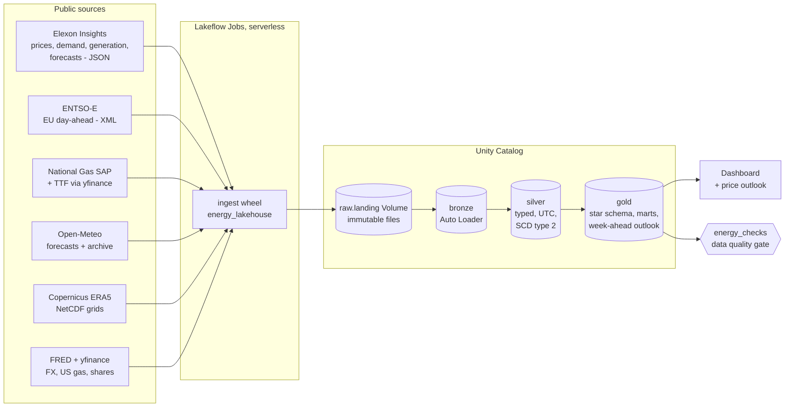

# GB Energy Markets Lakehouse

[](https://github.com/CodeWithBureh/energy-markets-lakehouse/actions/workflows/ci.yml)
[](LICENSE)

A production data platform on Azure Databricks that collects Great Britain's electricity
market data from seven public sources every morning, turns it into clean, tested tables,
and uses them to publish a **7-day forecast of the GB power price**. The forecast is scored
against nearly 1,000 past days to show how good it really is.

It is built and run the way a team would run it in production: infrastructure as code,
automated tests, a CI/CD pipeline that runs the real job before anything reaches prod, data
quality checks that stop bad data, and a tracked monthly cost.

**Stack:** Azure Databricks (serverless) · Unity Catalog · Lakeflow Declarative Pipelines
and Jobs · Delta Lake · Databricks Asset Bundles · Terraform · GitHub Actions · Python ·
PySpark · SQL

## At a glance

| | |
|---|---|
| Data | Half-hourly GB market data from 1 Jan 2024 to today: 1,060+ days, 50,000+ settlement periods, plus European prices, gas, weather and FX |
| Sources | 7 public APIs in JSON, XML, CSV and NetCDF, ingested daily at 07:40 UK time |
| Model | Bronze, silver and gold (medallion) in Unity Catalog: 18 silver tables (16 keep full revision history) and 13 gold tables |
| Quality | 97 automated tests; 50 data checks gate every deploy and every daily run |
| Delivery | Every change is deployed to a CI copy and run end to end before it is promoted to prod |
| Forecast | 1 day ahead: 13.3 GBP/MWh average error, a third better than the naive benchmark (20.2) |
| Cost | About $39 a month of Databricks compute for the pipeline and jobs |

## The problem

GB wholesale electricity is priced every half hour. Prices are driven mostly by gas prices
and by how much demand is left after wind and solar ("residual demand"), so a useful view
of the market needs prices, demand, generation, weather and gas side by side.

That data is public but awkward to combine:

- **Seven providers, four formats.** Elexon (GB market) publishes JSON, ENTSO-E (European
  prices) XML, National Gas CSV and Copernicus (weather reanalysis) NetCDF grids, alongside
  FX, share price and weather forecast APIs.
- **Different grains and units.** Half-hourly power, hourly weather, daily gas, trading-day
  FX; pence, pounds and euros; Kelvin and Celsius.
- **The calendar is irregular.** A GB trading day normally has 48 half-hour settlement
  periods, but 46 or 50 on the days the clocks change.
- **History changes.** Providers revise past data, and re-publish unchanged data.
- **Forecasts go stale.** A forecast is only fair to use if it was published before the
  moment you're predicting from.

This project builds a pipeline that handles all of that reliably, every day, at low cost.

## What it produces

- **Clean, joined tables** in Unity Catalog (gold layer): a half-hourly GB market fact
  table, a daily market summary across GB and its neighbours, weather by hour, a wind power
  curve, and data-quality tables. Every column is documented in the
  [data dictionary](docs/data-dictionary.md).
- **A week-ahead price outlook,** refreshed every morning: for each of the next 7 days, an
  estimated average GB price and a likely range, with the forecasts behind it.
- **A dashboard** of the market, the outlook and its accuracy, and the platform's own
  health (data freshness, checks and cost). It is defined as code and deployed with the
  rest of the project.

<!-- Dashboard screenshots go here: docs/images/dashboard-*.png -->

## Results

### The forecast, measured honestly

Every past forecast back to March 2024 has been rebuilt using only the data that was
available at 07:40 that morning, including the weather forecasts as they were then (from
an archive, not today's hindsight). Each one is then compared with the price that actually
happened.

The benchmark to beat is "the next 7 days will look like the last 7 days". Average error in
GBP/MWh, lower is better:

| Days ahead | 1 | 2 | 3 | 4 | 5 | 6 | 7 |
|---|---|---|---|---|---|---|---|
| **This model, all 980+ forecasts** | **13.3** | **13.9** | **14.3** | **15.0** | **15.8** | **16.7** | **17.1** |
| Same as the last 7 days | 20.2 | 20.7 | 21.0 | 21.1 | 21.2 | 21.3 | 21.4 |
| This model, Mar 2024 to Jun 2026 (average price 82) | 12.5 | 12.9 | 13.2 | 13.9 | 14.6 | 15.5 | 15.9 |
| This model, Jul to Nov 2026 (average price 145) | 18.4 | 19.6 | 20.2 | 20.9 | 22.9 | 24.3 | 24.2 |
| Same as the last 7 days, Jul to Nov 2026 | 29.4 | 30.2 | 31.2 | 31.6 | 31.6 | 31.2 | 31.2 |

Scored on 26 Nov 2026 with [`sql/week_ahead_backtest.sql`](sql/week_ahead_backtest.sql).

- **It beats the benchmark at every horizon and in both periods:** by about a third one
  day ahead, narrowing to about a fifth at seven days.
- **The last five months are harder.** Average prices rose from 82 to 145 GBP/MWh and moved
  less closely with residual demand, so errors grew in GBP. Relative to the price level they
  did not: one day ahead the error is about 13% of the price, against 15% before.
- **What limits it:** forecasting residual demand. With perfect knowledge of residual demand
  the error would fall by about 16%; with perfect knowledge of gas, only by 2%.

The model itself is deliberately simple (a regression on residual demand and gas, refitted
daily on the last 60 days and blended with the recent price) and lives in SQL. Any change to
it goes through a [research bench](research/README.md) that scores candidates on held-out
months and only accepts one that wins there and in both halves of the earlier data.

### The platform

- **Daily runs with no manual steps:** ingest, pipeline refresh and checks run on a
  schedule; failures alert by email.
- **Safe to re-run:** backfills fetch only missing months, and unchanged downloads are
  skipped, so re-running history costs almost nothing.
- **Cost:** about $39 a month of Databricks compute for the pipeline and jobs, including a
  full backfill. Details are in [Cost](#cost).

## Architecture



1. **Ingest.** A Python package, built as a wheel and run by Lakeflow Jobs, calls each API
   and saves the raw responses unchanged as files in a Unity Catalog Volume.
2. **Bronze.** Auto Loader picks up new files incrementally.
3. **Silver.** Data is parsed, typed, converted to UTC and validated. Changes are merged as
   SCD type 2, so every revision a provider publishes is kept and duplicates are not.
4. **Gold.** Facts, dimensions and marts for analysis, plus the inputs to the week-ahead
   outlook.

There are four jobs: `energy-daily` (07:40 UK: ingest, then the pipeline),
`energy-weekly-weather` (ERA5 reanalysis, Mondays), `energy-backfill` (month by month, only
what is missing) and `energy-checks` (freshness, uniqueness, completeness, price ranges).

## Engineering highlights

| Problem | How it's handled |
|---|---|
| Clock-change days have **46 or 50** half-hours | Settlement times derived from local midnight in 30-minute steps; `dim_date` knows each day's count; a completeness check and DQ table catch missing periods |
| Sources **revise** past data and re-publish unchanged data | Immutable landing files; silver merged with AUTO CDC as **SCD type 2**, comparing data columns only, so revisions are kept and duplicates aren't |
| Forecasts must not **leak the future** into features | Every forecast vintage kept, keyed by publish time; gold picks the latest one published before each cutoff |
| ENTSO-E **XML** (positions not timestamps, omitted repeats, 15 and 60-minute mixes) and **NetCDF** grids | Dedicated, unit-tested parsers; NetCDF flattened to Parquet for Auto Loader |
| Re-running a backfill shouldn't re-download history | Per-source settle periods; settled days and unchanged payloads are skipped |
| A bad deploy shouldn't reach prod | Each merge deploys a CI copy, runs the real daily job and the data checks; only then is prod updated |
| Mixed grains and units | Half-hourly power, hourly weather, daily gas and FX, trading-day shares; pence to pounds, EUR to GBP, K to deg C |
| Cost | Serverless only, triggered (not continuous) pipeline, gold views that refresh as no-ops when nothing changed, task timeouts |

The reasoning and trade-offs behind each choice: [docs/design-decisions.md](docs/design-decisions.md).

## Data quality and testing

- **Expectations** on every silver view drop or flag bad rows (periods outside 1 to 50,
  missing prices, implausible values).
- **`energy_checks`** fails the run when a required check fails: every table has rows,
  current silver rows are unique on their keys, prices are fresh and within range, and no
  settlement day in the last 30 is incomplete.
- **Tests** run on every pull request:
  - ingestion clients and parsers against recorded API responses;
  - the silver and gold transformations on local Spark ([tests/pipeline](tests/pipeline)),
    covering clock-change days, forecast vintages, the outlook's fallbacks and
    volume-weighted prices;
  - the research bench.

## Deployment

**Infrastructure as code.** Terraform ([infra/](infra/)) manages the platform: the Unity
Catalog catalogs and grants, service principals, the Key Vault and secret scope for API
keys, and the SQL warehouse. Databricks Asset Bundles ([databricks.yml](databricks.yml))
manage what runs on it: the pipeline, jobs, schemas, Volume and dashboard. Terraform state
is kept in Azure Storage, with versioning on.

**Environments.** `dev`, `ci` and `prod` share one workspace (keeping the fixed cost near
zero) and are isolated by catalog and identity. Prod and CI run as their own service
principals; nobody's personal credentials do.

**CI/CD** (GitHub Actions):

```
feature branch --PR--> dev --automatic PR--> main
  lint, tests,         deploy CI copy,        deploy prod,
  validate bundles,    run daily job,         run checks
  validate Terraform   run checks
```

Details: [docs/setup.md](docs/setup.md#cicd-flow).

## Cost

Databricks list prices from `system.billing`, 1 to 26 Nov 2026, excluding Azure storage:

| Item | USD |
|---|---|
| Pipeline (Lakeflow) | 22.4 |
| Jobs (ingest) | 10.2 |
| Predictive optimization | 6.5 |
| SQL warehouse | 108.7 |

Running the platform (pipeline and jobs, including a full backfill) cost about $39. The
warehouse figure is ad-hoc analysis over five days, on a warehouse larger than the project
needs. It now runs at 2X-Small with a 5-minute auto-stop, set in Terraform. Queries 5 and 5b
in [`sql/dashboard_and_cost_queries.sql`](sql/dashboard_and_cost_queries.sql) track cost
over time.

## Repository layout

```
databricks.yml               bundle: dev, ci and prod targets
resources/                   schemas and Volume, the pipeline, four jobs
src/energy_lakehouse/        ingestion library, built into a wheel
  sources/  parsers/         one client per source; ENTSO-E XML and ERA5 NetCDF parsers
  landing.py  cli.py         landing files, settle periods, the ingest entry point
  checks.py  backfill.py     data checks job; month planning for backfills
src/pipeline/                bronze.py, silver.py, gold.py (Lakeflow Declarative Pipeline)
sql/                         week-ahead report and backtest, dashboard and cost queries
research/                    model bench: snapshot, walk-forward scoring, promotion gates
infra/                       Terraform: azure/ (Key Vault, state storage), databricks/ (catalogs, grants, identities, warehouse)
tests/                       pytest; tests/pipeline runs the pipeline on local Spark
docs/                        setup, data dictionary, design decisions
.github/workflows/ci.yml     lint, test, validate; deploy CI on dev, prod on main
```

## Documentation

- [Setup and operations](docs/setup.md): accounts, Azure, secrets, service principals,
  deploys, backfills, troubleshooting
- [Infrastructure](infra/README.md): the Terraform stacks and how to work on them
- [Data dictionary](docs/data-dictionary.md): every silver and gold table and column,
  generated from Unity Catalog by `scripts/data_dictionary.py`
- [Design decisions](docs/design-decisions.md): what was chosen, why, and what it costs
- [Model research bench](research/README.md): how forecast changes are tested

## Data sources and licences

| Source | Data | Licence or terms |
|---|---|---|
| [Elexon Insights](https://bmrs.elexon.co.uk/api-documentation) | GB prices, demand, generation, forecasts | Elexon BMRS terms (free, no key) |
| [ENTSO-E Transparency](https://transparency.entsoe.eu/) | EU day-ahead prices | ENTSO-E terms (free registration) |
| [National Gas data portal](https://data.nationalgas.com/) | GB gas SAP | National Gas terms |
| [Open-Meteo](https://open-meteo.com/) | Weather forecasts and archived forecasts | CC BY 4.0, non-commercial |
| [Copernicus ERA5](https://cds.climate.copernicus.eu/) | Hourly weather reanalysis | Copernicus licence |
| [FRED](https://fred.stlouisfed.org/) | FX, Henry Hub, EU gas | FRED terms |
| [Yahoo Finance](https://finance.yahoo.com/) via yfinance | Share prices, TTF gas | Personal use only |

The code is released under the [MIT License](LICENSE). The data stays under each
provider's terms above.

## How it was built

Built with Claude Code as a pair programmer. Commits it co-wrote say so in their messages.
