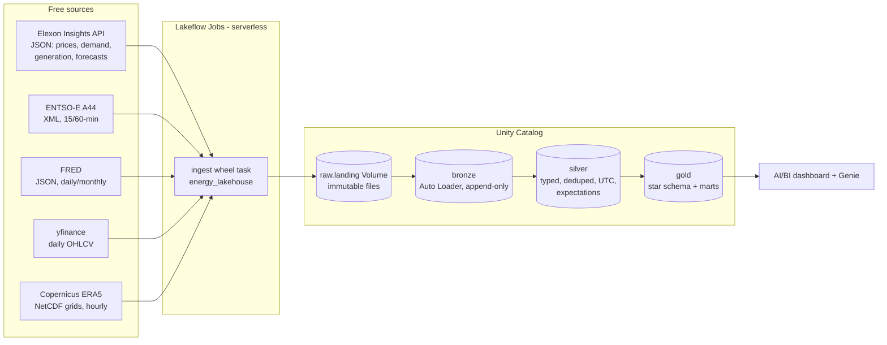

# GB Energy Markets Lakehouse

**Do power, gas and weather moves show up in UK energy stocks?**

This is an Azure Databricks lakehouse that ingests GB balancing-market data (Elexon), European
day-ahead prices (ENTSO-E), gas and FX (FRED), share prices for London-listed energy companies
and ERA5 weather reanalysis (Copernicus). It models them into a medallion architecture and
serves a dashboard. Everything is deployed as code with Databricks Asset Bundles and is
designed to run for **under £75/month** (expected £30–45).



## Why it's interesting (the hard parts)

| Challenge | Where it's handled |
|---|---|
| GB settlement days have **46 / 48 / 50** half-hours on clock-change days | `timeutils.py`, `silver.settlement_start_utc`, `gold.dim_date`, `gold.dq_settlement_period_completeness` |
| ENTSO-E **XML**: namespaces, Point *positions* instead of timestamps, **A03 curves omit repeated values**, mixed **15-min and 60-min** resolutions | `parsers/entsoe_xml.py` (unit-tested), `gold.fact_eu_day_ahead_hourly` |
| **NetCDF** weather grids (time × lat × lon) that Spark can't read | `parsers/era5_netcdf.py` → Parquet → Auto Loader |
| **Revisions** (Elexon re-settles periods) | Append-only bronze with unique file names → silver keeps the latest version per key |
| Mismatched grains: half-hourly power, hourly weather, daily stocks (trading days only), monthly EU gas | Gold joins, forward-fills (FX/gas) and hour-ending weather alignment |
| Currencies: EUR prices, GBp share quotes, USD gas | FRED FX → `gold.dim_fx_daily`; pence → pounds in silver |
| Cost control | Serverless only, triggered pipeline, timeouts, `--max-days` guard, weekly ERA5, `system.billing` queries |

## Repo layout

```
databricks.yml                 bundle: dev + prod targets in one Azure workspace
resources/
  storage.yml                  schemas raw/bronze/silver/gold + landing Volume
  pipeline.yml                 one serverless Lakeflow Declarative Pipeline
  jobs.yml                     energy-daily + energy-weekly-weather jobs
src/energy_lakehouse/          ingestion library (built into a wheel)
  sources/                     elexon, entsoe, fred, stocks, era5 clients
  parsers/                     entsoe_xml, era5_netcdf
  landing.py  timeutils.py  cli.py  credentials.py  config.py
src/pipeline/                  bronze.py, silver.py, gold.py (Lakeflow pipeline code)
tests/                         pytest: clock changes, XML parsing, NetCDF flattening, cost guard
sql/                           dashboard and FinOps starter queries
.github/workflows/ci.yml       test + validate on PR, deploy and test the ci copy on dev, prod on main
```

## Data model (gold)

* `dim_date` (with expected settlement periods), `dim_company`, `dim_fx_daily`
* `fact_gb_half_hourly`: system price, market index price (APX), imbalance, demand and
  residual demand, generation mix, wind/gas share, weather
* `fact_gb_day_ahead_forecasts`: demand, wind and solar forecasts per settlement period, as
  published before the delivery day began (no look-ahead, so usable as model features)
* `fact_eu_day_ahead_hourly`: FR, NL, BE, NO2, DK1 and IE prices in EUR and GBP
* `fact_market_daily`: daily GB price stats, market index price, demand, neighbour prices,
  GB–FR spread, gas, FX, weather
* `fact_stock_returns_daily`: returns per ticker
* `mart_stocks_vs_market`: returns next to power/gas moves with rolling 60-day correlations
* `dq_settlement_period_completeness`: any day with missing or duplicate periods

## Getting started

### 1. Accounts and keys (all free)
| Source | What to do | Secret key name |
|---|---|---|
| Elexon | Nothing. The Insights API needs no key | – |
| ENTSO-E | Register at transparency.entsoe.eu, then email transparency@entsoe.eu for "Restful API access" | `entsoe-token` |
| FRED | Request a key at fred.stlouisfed.org | `fred-api-key` |
| Copernicus CDS | Create an account, copy the API key, **accept the ERA5 licence** on the dataset page | `cds-api-key` |
| yfinance | Nothing (unofficial; swap for Alpaca/Twelve Data if it breaks) | – |

### 2. Local development
```bash
python -m venv .venv && source .venv/bin/activate
pip install -e ".[dev]"
pytest -q
export ENTSOE_TOKEN=... FRED_API_KEY=... CDS_API_KEY=...
ingest --source elexon --landing-root ./landing --start 2026-10-24 --end 2026-10-26
```

### 3. Azure workspace (shared by dev and prod)
One workspace hosts both targets. They're kept apart by catalog: dev writes to
`energy_dev` (with schemas prefixed `dev_<you>_`), prod writes to `energy`.

1. **Workspace**: Premium tier, UK South, serverless enabled. Check the managed resource
   group for a **NAT gateway** (~£25–30/month idle). This project only uses serverless, so
   deploy without secure cluster connectivity, or budget for it.
2. **Catalogs**: create `energy_dev` and `energy` (managed storage on ADLS Gen2 via the
   Access Connector).
3. **Secrets**: a Key Vault-backed secret scope named `energy`, read by both targets
   (see [3a](#3a-key-vault-backed-secret-scope)).
4. **Service principal** for prod (see [3b](#3b-prod-service-principal)).
5. **Budgets**: in Azure Cost Management, set a budget on the subscription/resource group
   with alerts at £40 and £65.
6. **Readers group**: Settings → Identity and access → Groups → Add new, named
   `energy-readers` (an account-level group; Unity Catalog can't grant to workspace-local
   groups). Add yourself, then run `GRANT USE CATALOG ON CATALOG energy TO \`energy-readers\``.
   The bundle grants the group `USE SCHEMA` + `SELECT` on bronze/silver/gold and view
   access to the prod jobs and pipeline.
7. Set `workspace.host`, `alert_email` and `prod_service_principal` in `databricks.yml`.

#### 3a. Key Vault-backed secret scope

The API keys live in Azure Key Vault; the Databricks scope is only a pointer to it. Secret
names must match `SECRET_KEYS` in `config.py`.

1. **Create the vault** (Azure portal → Key vaults → Create): same resource group as the
   workspace, a globally unique name (e.g. `kv-energy-lakehouse`), UK South, Standard tier,
   **Azure role-based access control**, public network access on. If you restrict networking
   later, tick "Allow trusted Microsoft services".
2. **Let yourself write secrets**: vault → Access control (IAM) → Add role assignment →
   **Key Vault Secrets Officer** → your user.
3. **Let Databricks read them**: add **Key Vault Secrets User** for the **AzureDatabricks**
   application (`2ff814a6-3304-4ab8-85cb-cd0e6f879c1d`). Every read from the scope goes
   through this app, whoever runs the job.
4. **Add the secrets** (vault → Secrets → Generate/Import, or the CLI):
   ```bash
   az keyvault secret set --vault-name kv-energy-lakehouse --name entsoe-token --value "<token>"
   az keyvault secret set --vault-name kv-energy-lakehouse --name fred-api-key --value "<key>"
   az keyvault secret set --vault-name kv-energy-lakehouse --name cds-api-key  --value "<key>"
   ```
5. From the vault's **Properties** page, copy the **Vault URI** and the **Resource ID**.
6. **Create the scope** at `https://<workspace-url>#secrets/createScope` (case-sensitive;
   it isn't in the menus): scope name `energy`, manage principal **All workspace users**,
   DNS name = Vault URI, Resource ID = Resource ID.
7. **Check it**:
   ```bash
   databricks secrets list-scopes          # energy, backend AZURE_KEYVAULT
   databricks secrets list-secrets energy  # the three names
   ```
   The scope is read-only from Databricks (`put-secret` fails). Change keys in Key Vault;
   Databricks sees new values immediately.

#### 3b. Prod service principal

1. **Create it**: workspace → your name → Settings → Identity and access → Service principals
   → Add new. Name `energy-prod-sp`, **Databricks managed**, keep **Workspace access** (no
   cluster creation needed; everything is serverless).
2. Copy its **Application ID** into `prod_service_principal` in `databricks.yml`.
3. **OAuth secret for CI**: service principal → Secrets → Generate secret, scope
   **all-apis** (bundle deploys touch files, jobs, pipelines, Unity Catalog and secrets),
   lifetime 730 days. It's shown once; set a reminder to rotate it.
4. **Grant it the prod catalog only** (SQL editor):
   ```sql
   GRANT USE CATALOG, USE SCHEMA, CREATE SCHEMA, CREATE TABLE, CREATE MATERIALIZED VIEW,
         SELECT, MODIFY, READ VOLUME, WRITE VOLUME
   ON CATALOG energy TO `<application-id>`;
   ```
   Nothing on `energy_dev`, which keeps prod out of dev.
5. **Secret scope**: nothing to do. "All workspace users" already covers it, and it needs no
   Key Vault role because the AzureDatabricks app does the reading.
6. **Let yourself deploy as it**: service principal → Permissions → Grant access → your user
   → **Service principal: User** (workspace admins may already have this).
7. **GitHub**: repo → Settings → Environments → New environment `prod` (optionally limit it
   to the `main` branch and add yourself as a required reviewer). Add environment secrets
   `DATABRICKS_HOST`, `DATABRICKS_CLIENT_ID` (the Application ID) and
   `DATABRICKS_CLIENT_SECRET`. The deploy job in `ci.yml` uses `environment: prod`, so PR
   runs can't read them.

#### 3c. CI service principal (dev branch)

The `dev` branch deploys a shared test copy, the `ci` target: catalog `energy_dev`, schemas
`ci_raw`/`ci_bronze`/`ci_silver`/`ci_gold`, jobs named `[ci] …`, schedules paused. It runs as
its own service principal so it can't touch prod, and prod's can't touch it.

1. **Create it** as in 3b.1, named `energy-ci-sp`, and generate an OAuth secret (3b.3).
2. **Grant it the dev catalog only**:
   ```sql
   GRANT USE CATALOG, USE SCHEMA, CREATE SCHEMA, CREATE TABLE, CREATE MATERIALIZED VIEW,
         CREATE VOLUME, SELECT, MODIFY, READ VOLUME, WRITE VOLUME
   ON CATALOG energy_dev TO `<ci-application-id>`;
   ```
3. **GitHub**: add repository secrets `DEV_DATABRICKS_CLIENT_ID` and
   `DEV_DATABRICKS_CLIENT_SECRET`. Pull-request validation also reads them, so they're
   repository secrets rather than environment secrets.
4. **Seed it once**: Actions → ci → Run workflow on `dev`, with `seed_start_month` about
   three months back (e.g. `2026-08`), so monthly FRED series have rows. Later runs only need
   the daily job's rolling windows.

Only CI should deploy `-t ci`: its deployment state lives in the CI principal's home folder,
so a deploy from your laptop would create a second copy of every job.

### CI/CD flow

```
feature branch ──PR──▶ dev ──PR──▶ main
   tests,              deploy -t ci,   deploy -t prod,
   validate ci+prod    run it, check   validate-only, check
```

| Event | What runs |
| --- | --- |
| Pull request into `dev` or `main` | ruff, pytest with coverage, build the wheel and start each entry point, `bundle validate` for `ci` and `prod` |
| Pull request into `main` | also: the source branch must be `dev` (or `hotfix/*`) |
| Push to `dev` | `bundle deploy -t ci`, pipeline validate-only update, the full `energy_daily` job (fails on `SUCCESS_WITH_FAILURES` too), then `energy_checks` |
| Push to `main` | `bundle deploy -t prod`, pipeline validate-only update, `energy_checks` against prod data (read-only; the schedule owns the runs) |

`energy_checks` (`src/energy_lakehouse/checks.py`) fails the run when a required check
fails: every silver and gold table has rows, current silver rows are unique on their keys,
GB and EU prices reach within `max_age_days` (default 3) of today, no incomplete settlement
days in the last 30, and GB prices are present and within range. ERA5 checks only warn,
because only the weekly job loads weather. Run it any time:
```bash
databricks bundle run -t prod energy_checks
databricks bundle run -t dev energy_checks --params max_age_days=7   # dev is rarely run
```

Recommended repo settings: protect `dev` and `main` (pull requests only, require the `test`
and `validate` checks, plus `promotion-guard` on `main`), and add a required reviewer to the
`prod` environment. Dependabot opens weekly update PRs against `dev`.

### 4. Dev
```bash
databricks auth login --host https://adb-<id>.<n>.azuredatabricks.net
databricks bundle deploy -t dev
databricks bundle run -t dev energy_daily    # ingest -> pipeline, rolling windows
# Backfill a specific window (max 31 days per run, the --max-days guard):
databricks bundle run -t dev energy_daily --params start=2026-10-01,end=2026-10-31
```
Schedules stay paused in dev, so it only costs money when you run something.

**Backfilling many months** uses the on-demand `energy_backfill` job. Each source loops over
the months inside Databricks (one month per iteration) and the pipeline refreshes once at the
end. Set the target and months in `backfill.toml`, then:
```bash
python scripts/backfill.py --dry-run   # show the plan
python scripts/backfill.py             # start the job and wait for it
```
or call the job directly:
```bash
databricks bundle run -t prod energy_backfill --params start_month=2024-01,end_month=current
databricks bundle run -t prod energy_backfill --params "months=2024-03 2024-10,include_weather=true"
databricks bundle run -t prod energy_backfill --params start_month=2024-01,end_month=current,weather_only=true
```
`weather_only=true` backfills ERA5 alone and skips the market sources (Elexon, ENTSO-E, FRED,
stocks). Expect it to be slow: the Copernicus queue can take up to an hour per month.
If some months fail, open the run and click **Repair run**: only the failed months rerun.

### 5. Prod
Pushes to `main` run the tests, deploy prod as the service principal (step 3b.7), then run a
validate-only pipeline update and `energy_checks` (see CI/CD flow).

> **Tip:** let CI run the first prod deploy rather than running `bundle deploy -t prod` from
> your laptop. CI signs in as the service principal, so the prod schemas and Volume end up
> owned by it rather than by you.

Once deployed, run or backfill it:
```bash
databricks bundle run -t prod energy_daily
databricks bundle run -t prod energy_daily --params start=2026-09-01,end=2026-09-30
```

## Cost guardrails (target ≤ £75/month)

| Item | Setting | Est. £/month |
|---|---|---|
| Daily job + pipeline | serverless, triggered, task timeouts, max 2 retries | 10–20 |
| Weekly ERA5 job | one CDS request per month touched, 90-min timeout | 2–5 |
| SQL warehouse | 2X-Small, serverless, minimum auto-stop | ~20 (≈10 h use) |
| Storage (ADLS) | a few GB | < 2 |
| Dev runs | same workspace, manual runs only, schedules paused | 3–8 |

Never run the pipeline in continuous mode, and never leave a warehouse running. Check
`sql/dashboard_and_cost_queries.sql` (queries 5 and 5b) weekly.

## Roadmap

Already in the scaffold:
- [x] Ingestion library with tests (clock changes, A03 XML, NetCDF)
- [x] Bundle: schemas, Volume, pipeline, two jobs, dev/prod targets
- [x] Medallion pipeline with expectations and DQ table

### Stage 1: Core build (one Azure workspace for dev + prod, ~£35–50/month)

**Phase 0: Accounts and keys**
- [ ] Request ENTSO-E API access (slowest, so start first)
- [ ] FRED API key
- [ ] Copernicus CDS account, API key, and the ERA5 licence accepted
- [ ] Azure Databricks workspace (Premium, serverless), catalogs `energy_dev` and `energy`
- [ ] Azure budget with alerts at £40 and £65
- [ ] Python 3.11, Git and the Databricks CLI installed locally

**Phase 1: Repo**
- [ ] Push to GitHub, create a venv, `pip install -e ".[dev]"`, `pytest -q` passes

**Phase 2: Local ingestion**
- [ ] Run `ingest` for Elexon, then FRED, stocks and ENTSO-E into `./landing`, and inspect the payloads

**Phase 3: Build in dev**
- [ ] `bundle deploy -t dev`, `bundle run -t dev energy_daily`
- [ ] Fix any schema mismatches (e.g. Elexon field names in `silver.py`)
- [ ] Gold tables queryable and expectations green

**Phase 4: Prod**
- [ ] Key Vault secrets plus a Key Vault-backed scope `energy`
- [ ] Prod service principal with grants on `energy` only
- [ ] `bundle deploy -t prod`, one manual run of `energy_daily`, cost checked next day

**Phase 5: Backfill**
- [ ] `python scripts/backfill.py` (energy_backfill job, Jan 2024 to today)
- [ ] ERA5 backfill last (slow CDS queue)

**Phase 6: Dashboard**
- [ ] 2X-Small serverless SQL warehouse with minimum auto-stop
- [ ] AI/BI dashboard: spikes vs returns, rolling correlations, wind vs price, GB vs neighbours, cost tile
- [ ] Genie space over gold (optional)

**Phase 7: CI/CD**
- [ ] Service principal, GitHub secrets, push to `main` tests and deploys

**Phase 8: Portfolio polish**
- [ ] Screenshots (pipeline graph, DQ metrics, dashboard), three written findings, cost table

### Stage 2: Go deeper (free)

**Phase 9: Full revision history**
- [ ] SCD Type 2 `gb_system_prices` using Lakeflow `AUTO CDC` (`__START_AT` / `__END_AT`)
- [ ] Gold "as-of" view: what did we think the price was on date X, as of date Y?

**Phase 10: Smarter weather**
- [ ] Land the UK REPD (wind-farm locations and capacity) and map farms to ERA5 grid cells
- [ ] `gb_wind_at_turbines_hourly` (capacity-weighted) and population-weighted temperature
- [ ] Compare against the simple average using actual wind output

**Phase 11: More sources**
- [ ] NESO Data Portal (demand forecasts) and the Carbon Intensity API (half-hourly CO₂)
- [ ] Join both into `fact_gb_half_hourly`

**Phase 12: Price forecasting with MLflow**
- [ ] Feature table from gold, a naive baseline, then a gradient-boosted model
- [ ] Experiments logged and best model registered in MLflow
- [ ] Weekly retrain task writing `gold.price_forecasts`, plus a forecast vs actual dashboard tile

**Phase 13: Testing and data contracts**
- [ ] `chispa` unit tests for silver and gold transforms in CI
- [ ] Expected schemas per source so API changes fail in CI, not in prod

**Phase 14: Free near-real-time streaming**
- [ ] Elexon IRIS consumer (local) landing messages every few minutes
- [ ] Streaming bronze table and a "today so far" dashboard page

### Stage 3: Production-grade (larger budget, ~£150–300/month while running)

**Phase 15: Production streaming, one month only (~£50–150)**
- [ ] Azure Event Hubs (Standard, Kafka-compatible) fed by IRIS and live share quotes
- [ ] Structured Streaming during trading hours only, demo video recorded, then switched off

**Phase 16: Intraday market data (~£20–100, pay-as-you-go)**
- [ ] Minute-level share data for the six companies (e.g. Databento)
- [ ] Event study: share moves in the 30 minutes after a GB price spike

**Phase 17: Serve and monitor the model (~£20–50)**
- [ ] Model Serving endpoint (CPU, scale-to-zero) for the Phase 12 model
- [ ] Lakehouse Monitoring on feature and forecast tables (drift, accuracy decay)

**Phase 18: AI market analyst (~£10–40)**
- [ ] Energy news headlines (Finnhub free API) with retrieval
- [ ] Genie space plus agent answering "why did Centrica fall on Tuesday?" from gold and news

**Phase 19: Enterprise infrastructure as code (~£30 extra for the NAT gateway)**
- [ ] Terraform: workspace with VNet injection, Key Vault, storage, Private Link, Unity Catalog objects
- [ ] Rebuild prod from scratch with `terraform apply` + `bundle deploy`

**Phase 20: Publish a data product (~£0–20)**
- [ ] Share gold via Delta Sharing or a small Databricks App
- [ ] Launch post linking the repo, dashboard and findings

**Suggested order:** Phases 9, 10 and 12 give the biggest portfolio boost; do 11 alongside 12, and 13
whenever CI feels thin. In Stage 3, run 15 and 17 together for one month, capture everything, then
shut them down.

## Troubleshooting

* **Wheel not found on serverless**: some CLI versions don't resolve `../dist/*.whl` in
  `environments`. Replace it with the absolute path
  `/Workspace${workspace.root_path}/artifacts/.internal/<wheel-name>.whl`.
* **ENTSO-E returns no rows**: tomorrow's prices are published around 13:00 CET. Before
  that you get an Acknowledgement document, which is logged, not treated as an error.
* **ERA5 request refused**: accept the dataset licence on the CDS website (one-off).

Data: Contains BMRS data © Elexon Limited copyright and database right. ENTSO-E
Transparency Platform. FRED®, Federal Reserve Bank of St. Louis. Copernicus Climate Change
Service (ERA5).
