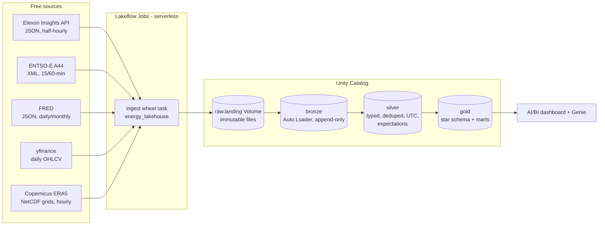

# GB Energy Markets Lakehouse

**Do power, gas and weather moves show up in UK energy stocks?**

This is an Azure Databricks lakehouse that ingests GB balancing-market data (Elexon), European
day-ahead prices (ENTSO-E), gas and FX (FRED), share prices for London-listed energy companies
and ERA5 weather reanalysis (Copernicus). It models them into a medallion architecture and
serves a dashboard. Everything is deployed as code with Databricks Asset Bundles and is
designed to run for **under £75/month** (expected £30–45).



## Why it's interesting (the hard parts)

| Challenge | Where it's handled |
|---|---|
| GB settlement days have **46 / 48 / 50** half-hours on clock-change days | `timeutils.py`, `silver.settlement_start_utc`, `gold.dim_date`, `gold.dq_settlement_period_completeness` |
| ENTSO-E **XML**: namespaces, Point *positions* instead of timestamps, **A03 curves omit repeated values**, mixed **15-min and 60-min** resolutions | `parsers/entsoe_xml.py` (unit-tested), `gold.fact_eu_day_ahead_hourly` |
| **NetCDF** weather grids (time × lat × lon) that Spark can't read | `parsers/era5_netcdf.py` → Parquet → Auto Loader |
| **Revisions** (Elexon re-settles periods) | Append-only bronze with unique file names → silver keeps the latest version per key |
| Mismatched grains: half-hourly power, hourly weather, daily stocks (trading days only), monthly EU gas | Gold joins, forward-fills (FX/gas) and hour-ending weather alignment |
| Currencies: EUR prices, GBp share quotes, USD gas | FRED FX → `gold.dim_fx_daily`; pence → pounds in silver |
| Cost control | Serverless only, triggered pipeline, timeouts, `--max-days` guard, weekly ERA5, `system.billing` queries |

## Repo layout

```
databricks.yml                 bundle: dev (Free Edition) + prod (Azure) targets
resources/
  storage.yml                  schemas raw/bronze/silver/gold + landing Volume
  pipeline.yml                 one serverless Lakeflow Declarative Pipeline
  jobs.yml                     energy-daily + energy-weekly-weather jobs
src/energy_lakehouse/          ingestion library (built into a wheel)
  sources/                     elexon, entsoe, fred, stocks, era5 clients
  parsers/                     entsoe_xml, era5_netcdf
  landing.py  timeutils.py  cli.py  credentials.py  config.py
src/pipeline/                  bronze.py, silver.py, gold.py (Lakeflow pipeline code)
tests/                         pytest: clock changes, XML parsing, NetCDF flattening, cost guard
sql/                           dashboard and FinOps starter queries
scripts/dev_ingest_and_upload.sh   laptop -> Free Edition Volume (dev only)
.github/workflows/ci.yml       test on PR, deploy to prod on main
```

## Data model (gold)

* `dim_date` (with expected settlement periods), `dim_company`, `dim_fx_daily`
* `fact_gb_half_hourly`: system price, imbalance, generation mix, wind/gas share, weather
* `fact_eu_day_ahead_hourly`: FR, NL, BE, NO2, DK1 and IE prices in EUR and GBP
* `fact_market_daily`: daily GB price stats, neighbour prices, GB–FR spread, gas, FX, weather
* `fact_stock_returns_daily`: returns per ticker
* `mart_stocks_vs_market`: returns next to power/gas moves with rolling 60-day correlations
* `dq_settlement_period_completeness`: any day with missing or duplicate periods

## Getting started

### 1. Accounts and keys (all free)
| Source | What to do | Secret key name |
|---|---|---|
| Elexon | Nothing. The Insights API needs no key | – |
| ENTSO-E | Register at transparency.entsoe.eu, then email transparency@entsoe.eu for "Restful API access" | `entsoe-token` |
| FRED | Request a key at fred.stlouisfed.org | `fred-api-key` |
| Copernicus CDS | Create an account, copy the API key, **accept the ERA5 licence** on the dataset page | `cds-api-key` |
| yfinance | Nothing (unofficial; swap for Alpaca/Twelve Data if it breaks) | – |

### 2. Local development
```bash
python -m venv .venv && source .venv/bin/activate
pip install -e ".[dev]"
pytest -q
export ENTSOE_TOKEN=... FRED_API_KEY=... CDS_API_KEY=...
ingest --source elexon --landing-root ./landing --start 2026-10-24 --end 2026-10-26
```

### 3. Dev on Databricks Free Edition (£0)
Free Edition only allows outbound calls to a list of trusted domains, so ingest on your
laptop and upload. (If you've verified with LinkedIn and have outbound access, you can run
the jobs directly.)
```bash
databricks auth login --host https://<your-free-edition>.cloud.databricks.com
# set the dev host in databricks.yml, then:
databricks bundle deploy -t dev
databricks bundle summary -t dev            # shows the prefixed Volume path
DEV_VOLUME=/Volumes/workspace/dev_<you>_raw/landing ./scripts/dev_ingest_and_upload.sh 2026-10-20 2026-10-26
databricks bundle run -t dev energy_pipeline
```

### 4. Prod on Azure Databricks
1. **Workspace**: Premium tier, UK South, serverless enabled. Check the managed resource
   group for a **NAT gateway** (~£25–30/month idle). This project only uses serverless, so
   deploy without secure cluster connectivity, or budget for it.
2. **Catalog**: create a catalog `energy` (managed storage on ADLS Gen2 via the Access Connector).
3. **Secrets**: create an Azure Key Vault with `entsoe-token`, `fred-api-key`, `cds-api-key`,
   then a Key Vault-backed secret scope named `energy`.
4. **Budgets**: in Azure Cost Management, set a budget on the subscription/resource group
   with alerts at £40 and £65.
5. Set the prod host and `alert_email`, then:
   ```bash
   databricks bundle deploy -t prod
   databricks bundle run -t prod energy_daily
   ```
   Backfill history in chunks of up to 31 days (the `--max-days` guard), e.g. one month per run.
6. **CI/CD**: add `DATABRICKS_HOST`, `DATABRICKS_CLIENT_ID`, `DATABRICKS_CLIENT_SECRET`
   (service principal) as GitHub secrets. Pushes to `main` then test and deploy.

## Cost guardrails (target ≤ £75/month)

| Item | Setting | Est. £/month |
|---|---|---|
| Daily job + pipeline | serverless, triggered, task timeouts, max 2 retries | 10–20 |
| Weekly ERA5 job | one CDS request per month touched, 90-min timeout | 2–5 |
| SQL warehouse | 2X-Small, serverless, minimum auto-stop | ~20 (≈10 h use) |
| Storage (ADLS) | a few GB | < 2 |
| Dev | Free Edition | 0 |

Never run the pipeline in continuous mode, and never leave a warehouse running. Check
`sql/dashboard_and_cost_queries.sql` (queries 5 and 5b) weekly.

## Roadmap

Already in the scaffold:
- [x] Ingestion library with tests (clock changes, A03 XML, NetCDF)
- [x] Bundle: schemas, Volume, pipeline, two jobs, dev/prod targets
- [x] Medallion pipeline with expectations and DQ table

### Stage 1: Core build (Free Edition dev + Azure prod, ~£30–45/month)

**Phase 0: Accounts and keys**
- [ ] Request ENTSO-E API access (slowest, so start first)
- [ ] FRED API key
- [ ] Copernicus CDS account, API key, and the ERA5 licence accepted
- [ ] Databricks Free Edition workspace
- [ ] Azure budget with alerts at £40 and £65
- [ ] Python 3.11, Git and the Databricks CLI installed locally

**Phase 1: Repo**
- [ ] Push to GitHub, create a venv, `pip install -e ".[dev]"`, `pytest -q` passes

**Phase 2: Local ingestion**
- [ ] Run `ingest` for Elexon, then FRED, stocks and ENTSO-E into `./landing`, and inspect the payloads

**Phase 3: Build on Free Edition**
- [ ] `bundle deploy -t dev`, upload landing files to the dev Volume, run the pipeline
- [ ] Fix any schema mismatches (e.g. Elexon field names in `silver.py`)
- [ ] Gold tables queryable and expectations green

**Phase 4: Azure prod**
- [ ] Premium tier and serverless confirmed, `energy` catalog created
- [ ] Key Vault secrets plus a Key Vault-backed scope `energy`
- [ ] `bundle deploy -t prod`, one manual run of `energy_daily`, cost checked next day

**Phase 5: Backfill**
- [ ] Ingest locally a month at a time (2024 to today), upload to the prod Volume, then one pipeline run
- [ ] ERA5 backfill last (slow CDS queue)

**Phase 6: Dashboard**
- [ ] 2X-Small serverless SQL warehouse with minimum auto-stop
- [ ] AI/BI dashboard: spikes vs returns, rolling correlations, wind vs price, GB vs neighbours, cost tile
- [ ] Genie space over gold (optional)

**Phase 7: CI/CD**
- [ ] Service principal, GitHub secrets, push to `main` tests and deploys

**Phase 8: Portfolio polish**
- [ ] Screenshots (pipeline graph, DQ metrics, dashboard), three written findings, cost table

### Stage 2: Go deeper (free)

**Phase 9: Full revision history**
- [ ] SCD Type 2 `gb_system_prices` using Lakeflow `AUTO CDC` (`__START_AT` / `__END_AT`)
- [ ] Gold "as-of" view: what did we think the price was on date X, as of date Y?

**Phase 10: Smarter weather**
- [ ] Land the UK REPD (wind-farm locations and capacity) and map farms to ERA5 grid cells
- [ ] `gb_wind_at_turbines_hourly` (capacity-weighted) and population-weighted temperature
- [ ] Compare against the simple average using actual wind output

**Phase 11: More sources**
- [ ] NESO Data Portal (demand forecasts) and the Carbon Intensity API (half-hourly CO₂)
- [ ] Join both into `fact_gb_half_hourly`

**Phase 12: Price forecasting with MLflow**
- [ ] Feature table from gold, a naive baseline, then a gradient-boosted model
- [ ] Experiments logged and best model registered in MLflow
- [ ] Weekly retrain task writing `gold.price_forecasts`, plus a forecast vs actual dashboard tile

**Phase 13: Testing and data contracts**
- [ ] `chispa` unit tests for silver and gold transforms in CI
- [ ] Expected schemas per source so API changes fail in CI, not in prod

**Phase 14: Free near-real-time streaming**
- [ ] Elexon IRIS consumer (local) landing messages every few minutes
- [ ] Streaming bronze table and a "today so far" dashboard page

### Stage 3: Production-grade (larger budget, ~£150–300/month while running)

**Phase 15: Production streaming, one month only (~£50–150)**
- [ ] Azure Event Hubs (Standard, Kafka-compatible) fed by IRIS and live share quotes
- [ ] Structured Streaming during trading hours only, demo video recorded, then switched off

**Phase 16: Intraday market data (~£20–100, pay-as-you-go)**
- [ ] Minute-level share data for the six companies (e.g. Databento)
- [ ] Event study: share moves in the 30 minutes after a GB price spike

**Phase 17: Serve and monitor the model (~£20–50)**
- [ ] Model Serving endpoint (CPU, scale-to-zero) for the Phase 12 model
- [ ] Lakehouse Monitoring on feature and forecast tables (drift, accuracy decay)

**Phase 18: AI market analyst (~£10–40)**
- [ ] Energy news headlines (Finnhub free API) with retrieval
- [ ] Genie space plus agent answering "why did Centrica fall on Tuesday?" from gold and news

**Phase 19: Enterprise infrastructure as code (~£30 extra for the NAT gateway)**
- [ ] Terraform: workspace with VNet injection, Key Vault, storage, Private Link, Unity Catalog objects
- [ ] Rebuild prod from scratch with `terraform apply` + `bundle deploy`

**Phase 20: Publish a data product (~£0–20)**
- [ ] Share gold via Delta Sharing or a small Databricks App
- [ ] Launch post linking the repo, dashboard and findings

**Suggested order:** Phases 9, 10 and 12 give the biggest portfolio boost; do 11 alongside 12, and 13
whenever CI feels thin. In Stage 3, run 15 and 17 together for one month, capture everything, then
shut them down.

## Troubleshooting

* **Wheel not found on serverless**: some CLI versions don't resolve `../dist/*.whl` in
  `environments`. Replace it with the absolute path
  `/Workspace${workspace.root_path}/artifacts/.internal/<wheel-name>.whl`.
* **ENTSO-E returns no rows**: tomorrow's prices are published around 13:00 CET. Before
  that you get an Acknowledgement document, which is logged, not treated as an error.
* **ERA5 request refused**: accept the dataset licence on the CDS website (one-off).

Data: Contains BMRS data © Elexon Limited copyright and database right. ENTSO-E
Transparency Platform. FRED®, Federal Reserve Bank of St. Louis. Copernicus Climate Change
Service (ERA5).
