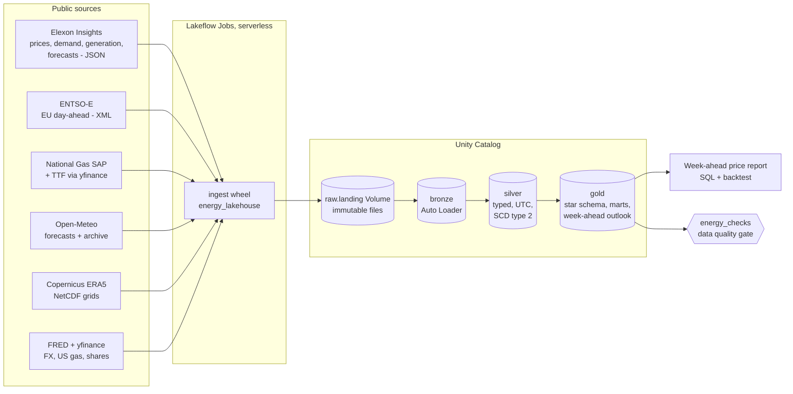

# GB Energy Markets Lakehouse

[](https://github.com/CodeWithBureh/energy-markets-lakehouse/actions/workflows/ci.yml)

An Azure Databricks lakehouse for the GB power market. It ingests seven public sources
every morning (balancing-market data, European prices, gas, weather forecasts, weather
reanalysis, FX and share prices), models them through bronze, silver and gold layers, and
publishes a **week-ahead GB power price outlook** that is backtested against 980 past
issues.

Everything is deployed as code with Databricks Asset Bundles and runs on serverless compute,
promoted from dev to prod only after a full run passes data checks.

| | |
|---|---|
| History | Jan 2024 to today, half-hourly (50,000+ settlement periods) |
| Tables | 18 silver (16 with full revision history), 13 gold |
| Tests | 97: ingestion, parsers, silver and gold transformations on local Spark, model bench |
| Outlook accuracy | 13.3 GBP/MWh average error 1 day ahead, 17.2 at 7 days; "same as last week" is 20-21 |
| Running cost | About $39 a month at Databricks list price for pipeline and jobs (Nov 2026, backfills included) |

## Architecture



Four jobs: `energy-daily` (07:40 UK: ingest, then the pipeline), `energy-weekly-weather`
(ERA5, Mondays), `energy-backfill` (month by month, only what is missing) and
`energy-checks` (freshness, uniqueness, completeness, price ranges).

## Engineering highlights

| Problem | How it's handled |
|---|---|
| Clock-change days have **46 or 50** half-hours | Settlement times from local midnight + 30-minute steps; `dim_date` knows each day's count; completeness checks and a DQ table |
| Sources **revise** past data and re-publish unchanged data | Immutable landing files; silver merged with AUTO CDC as **SCD type 2**, comparing data columns only, so revisions are kept and duplicates aren't |
| Forecasts must not **leak the future** into features | Every vintage kept, keyed by publish time; gold picks the latest published before each cutoff |
| ENTSO-E **XML** (positions not timestamps, omitted repeats, 15/60-min mixes) and **NetCDF** grids | Dedicated, unit-tested parsers; NetCDF flattened to Parquet for Auto Loader |
| Re-running a backfill shouldn't re-download history | Per-source settle periods; settled days and unchanged payloads are skipped |
| A bad deploy shouldn't reach prod | Each push to `dev` deploys a ci copy, runs the real daily job and the data checks; only then is `main` promoted |
| Mixed grains and units | Half-hourly power, hourly weather, daily gas and FX, trading-day shares; pence to pounds, EUR to GBP, K to deg C |
| Cost | Serverless only, triggered pipeline, deterministic gold views that refresh as no-ops, task timeouts |

Why each choice was made, and what it costs: [docs/design-decisions.md](docs/design-decisions.md).

## Week-ahead price outlook

Each morning, `fact_gb_week_ahead_outlook` combines Elexon's 2-14 day demand forecast,
Elexon's wind forecast (with a correction for its known overshoot) or an Open-Meteo wind
forecast through a fitted power curve, and the latest gas prices.
[`sql/week_ahead_report.sql`](sql/week_ahead_report.sql) turns that into a price estimate
and range for each of the next 7 days.

Past issues back to March 2024 are rebuilt from archived forecasts, using only what was
known at 07:40 each day, so [`sql/week_ahead_backtest.sql`](sql/week_ahead_backtest.sql)
scores the report honestly:

| Days ahead | 1 | 2 | 3 | 4 | 5 | 6 | 7 |
|---|---|---|---|---|---|---|---|
| Report, mean absolute error (GBP/MWh) | **13.3** | **13.9** | **14.3** | **15.0** | **15.9** | **16.8** | **17.2** |
| "Same as the last 7 days" | 20.2 | 20.8 | 21.0 | 21.2 | 21.3 | 21.3 | 21.4 |

Changes to the model go through a research bench ([research/](research/)) that scores them
on a held-out period and only promotes one that wins there and in both halves of the rest.

## Data quality and testing

- **Expectations** on every silver source view drop or flag bad rows (periods outside 1-50,
  missing prices, implausible values).
- **`energy_checks`** fails a run when a required check fails: every table has rows,
  current silver rows are unique on their keys, prices are fresh, no incomplete settlement
  days in the last 30.
- **Tests** run on every pull request: ingestion clients and parsers against recorded
  payloads, and the silver and gold transformations on local Spark
  ([tests/pipeline](tests/pipeline)), covering clock-change days, forecast vintages, the
  outlook's fallbacks and volume-weighted prices.

## CI/CD

```
feature branch --PR--> dev --automatic PR--> main
  lint, tests,         deploy ci copy,        deploy prod,
  validate bundles     run daily job, checks  checks
```

Service principals deploy and run ci and prod; nobody's personal credentials do. Details:
[docs/setup.md](docs/setup.md#cicd-flow).

## Cost

Databricks list prices from `system.billing`, 1-26 Nov 2026, excluding Azure storage:

| Item | USD |
|---|---|
| Pipeline (Lakeflow) | 22.4 |
| Jobs (ingest) | 10.2 |
| Predictive optimization | 6.5 |
| SQL warehouse | 108.7 |

The pipeline and jobs, including a full backfill this month, cost about $39. The SQL
warehouse cost is ad-hoc analysis on five days, on a warehouse larger than this project
needs. Moving it to 2X-Small with a short auto-stop cuts that by about two thirds. Queries
5 and 5b in [`sql/dashboard_and_cost_queries.sql`](sql/dashboard_and_cost_queries.sql) track it.

## Repo layout

```
databricks.yml               bundle: dev, ci and prod targets
resources/                   schemas and Volume, the pipeline, four jobs
src/energy_lakehouse/        ingestion library, built into a wheel
  sources/  parsers/         one client per source; ENTSO-E XML and ERA5 NetCDF parsers
  landing.py  cli.py         landing files, settle periods, the ingest entry point
  checks.py  backfill.py     data checks job; month planning for backfills
src/pipeline/                bronze.py, silver.py, gold.py (Lakeflow Declarative Pipeline)
sql/                         week-ahead report and backtest, dashboard and cost queries
research/                    model bench: snapshot, walk-forward scoring, promotion gates
tests/                       pytest; tests/pipeline runs the pipeline on local Spark
docs/                        setup, data dictionary, design decisions
.github/workflows/ci.yml     lint, test, validate; deploy ci on dev, prod on main
```

## Documentation

- [Setup and operations](docs/setup.md): accounts, Azure, secrets, service principals,
  deploys, backfills, troubleshooting
- [Data dictionary](docs/data-dictionary.md): every silver and gold table and column,
  generated from Unity Catalog by `scripts/data_dictionary.py`
- [Design decisions](docs/design-decisions.md)
- [Model research bench](research/README.md)

## Data sources and licences

| Source | Data | Licence or terms |
|---|---|---|
| [Elexon Insights](https://bmrs.elexon.co.uk/api-documentation) | GB prices, demand, generation, forecasts | Elexon BMRS terms (free, no key) |
| [ENTSO-E Transparency](https://transparency.entsoe.eu/) | EU day-ahead prices | ENTSO-E terms (free registration) |
| [National Gas data portal](https://data.nationalgas.com/) | GB gas SAP | National Gas terms |
| [Open-Meteo](https://open-meteo.com/) | Weather forecasts and archived forecasts | CC BY 4.0, non-commercial |
| [Copernicus ERA5](https://cds.climate.copernicus.eu/) | Hourly weather reanalysis | Copernicus licence |
| [FRED](https://fred.stlouisfed.org/) | FX, Henry Hub, EU gas | FRED terms |
| [Yahoo Finance](https://finance.yahoo.com/) via yfinance | Share prices, TTF gas | Personal use only |

## Roadmap

- [ ] Dashboard defined in the bundle, with screenshots
- [ ] Terraform for the Azure workspace, storage, Key Vault, Unity Catalog and grants
- [ ] Model improvements through the research bench ([ideas](research/ideas.md))
- [ ] Recent weather from Open-Meteo to fill the days before ERA5 lands
- [ ] Wind measured at wind-farm locations (UK REPD) instead of a GB average
- [ ] Near-real-time Elexon data (IRIS) for a "today so far" view

## How it was built

Built with Claude Code as a pair programmer. Commits it co-wrote say so in their messages.
